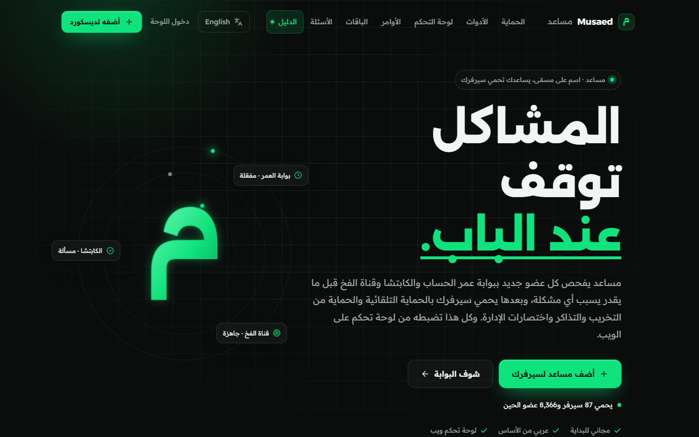

# Musaed website

The website for **مساعد (Musaed)**, a Discord bot that guards Arabic servers and talks in Saudi dialect. It's live at [musaed.dev](https://musaed.dev).



## Why I made it

The big Discord bots speak English and aren't built with Arabic servers in mind, so I made Musaed. Before you give a bot admin rights in your server, you want to know exactly what it does, in your own language. This site is where you find that out.

## What it does

- Shows what Musaed protects your server from before you add it: the age check, the captcha, the trap channel, the auto-mod and the anti-nuke
- Lets you try the join check and the dashboard right on the page
- Arabic first, English one click away
- A full setup guide in Arabic at [musaed.dev/guide](https://musaed.dev/guide/)
- A 22-second video of the bot at work
- A live count of how many servers and members it protects right now
- A privacy policy and terms written in plain words

## Get the bot

You don't need anything from this repo to use Musaed. Go to [musaed.dev](https://musaed.dev) and press «أضف مساعد لسيرفرك» (Add to Discord), then set it up at [dashboard.musaed.dev](https://dashboard.musaed.dev). If you get stuck, ask in the [support server](https://discord.gg/CcwRT6K5qv).

## Run the site on your computer

You need [Python](https://www.python.org/downloads/).

1. Download this repo (green **Code** button → **Download ZIP**), or clone it:

   ```bash
   git clone https://github.com/musaed-dev/Musaed-Web.git
   cd Musaed-Web
   ```

2. Start a small local server in that folder:

   ```bash
   python -m http.server 8000
   ```

3. Open [http://localhost:8000](http://localhost:8000) in your browser.

Use the local server rather than double-clicking `index.html`. Some browsers block the fonts when a page is opened as a file.

## Good to know

- This is only the website. The bot and the dashboard are separate projects.
- The privacy policy, the terms and the guide are in Arabic only for now.
- The live server count only shows on musaed.dev. On your own computer that line stays hidden.
- With JavaScript turned off, the home page shows its English text in a right-to-left layout.

## For development

Plain HTML, CSS and JavaScript. No build step and nothing to install.

- The pages are `index.html`, `privacy.html`, `terms.html`, `404.html` and the guide in `guide/`.
- Styles are in `assets/css/` and scripts in `assets/js/`. The Arabic text lives in `assets/js/i18n.js`; the English is in the HTML itself.
- Fonts and the video are hosted here (`assets/fonts/`, `assets/video/`), so no fonts or videos come from other websites.
- After changing a CSS or JS file, bump its `?v=` number in every page that loads it, so browsers fetch the new copy.
- There are no automated tests. Check changes in a browser in both languages, at desktop and phone width.
- To deploy, upload the folder as it is to any static host.
